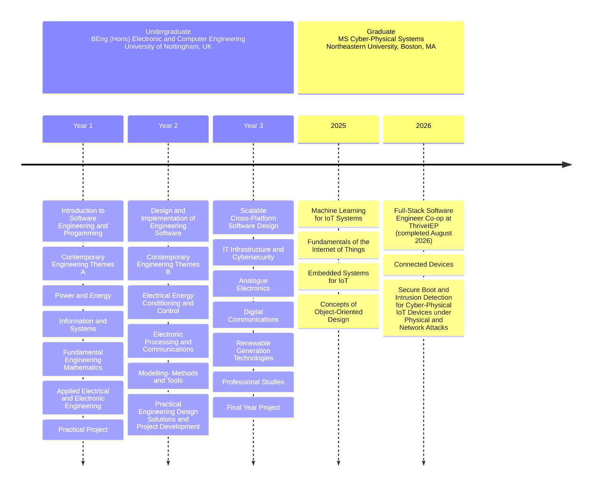

# Hi there 👋

Thank you for stopping by my GitHub profile! I am pursuing a Master of Science degree in Cyber-Physical Systems at Northeastern University (Boston, MA), having completed my full-stack engineering co-op at ThriveIEP, an ed-tech startup based in the Greater Boston area, in August.

I am currently taking the _Connected Devices_ course (based on the [Programming the IoT](https://github.com/programming-the-iot) textbook), taught by Andy King, and working on a project titled _Secure Boot and Intrusion Detection for Cyber-Physical IoT Devices under Physical and Network Attacks_. I am expecting to graduate in May 2027 and am open to opportunities following graduation.

I hold a Bachelor of Engineering degree in Electronic and Computer Engineering from the University of Nottingham in the UK, having graduated in December 2024.

## Courses Taken:

## Certifications earned

* [ISC2 Certified in Cybersecurity (CC)](https://www.credly.com/badges/58cd4242-2597-4c6e-a31a-fe79deb416dd/public_url)
  * Certification Cycle: Oct 1, 2025 - Sep 30, 2028
  * Certified since: 2025

## Certifications of interest

* [Claude Certified Associate - Foundations](https://anthropic-partners.skilljar.com/path/claude-certified-associate-foundations)
* [Claude Certified Developer - Foundations](https://anthropic-partners.skilljar.com/path/claude-certified-developer-foundations)
* [Claude Certified Architect - Foundations](https://anthropic-partners.skilljar.com/claude-certified-architect-foundations-certification)
* [Claude Certified Architect - Professional](https://anthropic-partners.skilljar.com/path/claude-certified-architect-professional)

## Let's connect!

[LinkedIn](https://linkedin.com/in/sohampatwardhan149) | [NUworks](https://northeastern-csm.symplicity.com/profiles/soham.patwardhan) | [Credly](https://www.credly.com/users/sohampatwardhan/) | [ORCID](https://orcid.org/0000-0001-7257-0422)

<!--
**sohampatwardhan/sohampatwardhan** is a ✨ _special_ ✨ repository because its `README.md` (this file) appears on your GitHub profile.

Here are some ideas to get you started:

- 🔭 I’m currently working on ...
- 🌱 I’m currently learning ...
- 👯 I’m looking to collaborate on ...
- 🤔 I’m looking for help with ...
- 💬 Ask me about ...
- 📫 How to reach me: ...
- 😄 Pronouns: ...
- ⚡ Fun fact: ...
-->
